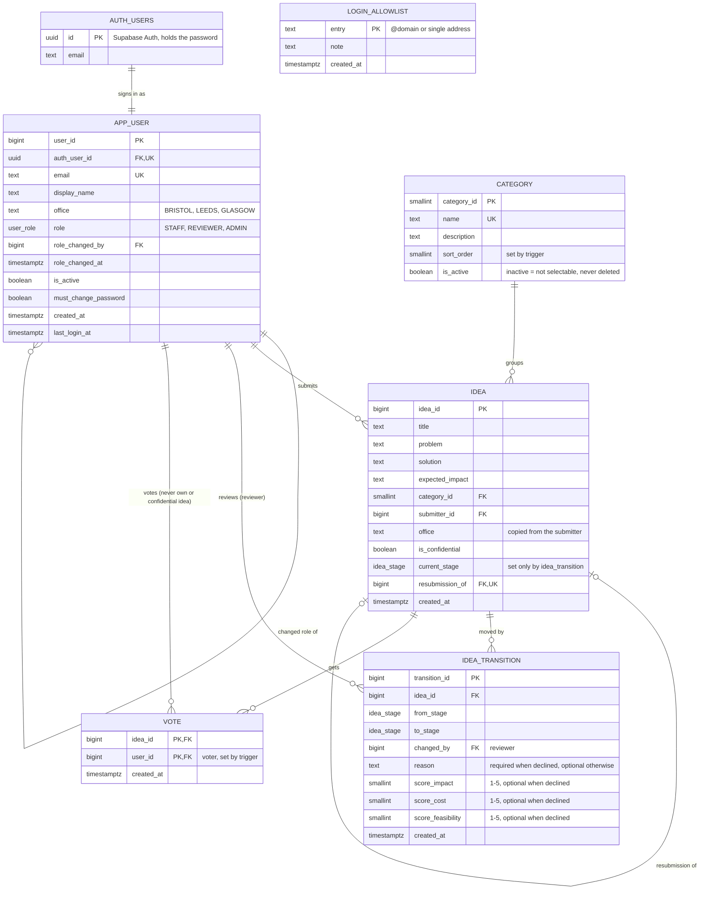

# IdeaForge: implemented data model (Supabase)

Simple overview of the tables that exist in Supabase today (schema `public`, plus the link to `auth.users`).
Update this diagram after each Supabase migration.

- Last update: 2026-10-12, after migration `20261012193813_category_admin_write.sql` (no new tables or columns; only admins can write `category`)
- Source: `build/supabase/migrations/`
- Planned full model: `design/DataModel/V2-StammdatenIntegriert/`

## Enums
- `user_role`: STAFF, REVIEWER, ADMIN
- `idea_stage`: SUBMITTED → UNDER_REVIEW → PILOTING → IMPLEMENTED, or DECLINED

`login_allowlist` has no foreign keys. It is checked by `handle_new_user()` when a new Auth user is created.
